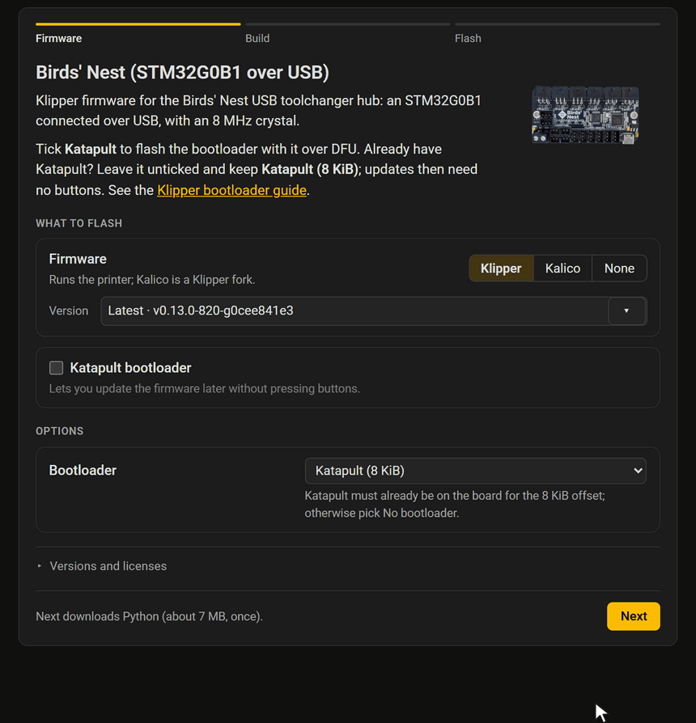

# WebFlash

> [!NOTE]
> This project currently is in beta, with limited testing done.
>
> Tested:
> - STM32G0B1, Klipper and Kalico, CAN and USB, with and without Katapult. Klipper connects on all, but not tested on a real printer.
> - STM32F072, Klipper in CAN bridge mode, without Katapult. Klipper connects on all, but not tested on a real printer.
> - RP2040, Klipper, USB, with and without Katapult. Klipper connects on all, but not tested on a real printer.
> - Every available ARM config (AVR isn't supported), all compile, but not tested on hardware.
>
> If you test anything we haven't tested yet (including using above chips on an actual printer), let me know how it went. Feedback like that helps a lot with making sure everything is good.

Configure, build and flash Klipper, Kalico and Katapult firmware for 3D printer boards from a web browser, with nothing to install. WebFlash shows the project's own `make menuconfig` options, compiles the firmware in the browser with clang and lld built to WebAssembly, and flashes it over USB: the STM32 DFU bootloader, RP2040 and RP2350 PICOBOOT and UF2, and Katapult over USB, UART and CAN. It also turns a board's firmware settings into a themed card for that board's documentation, so readers build and flash the right firmware in one place.



*A card for the [Birds' Nest](https://docs.isiks.tech/birds-nest/usb/manual/) building Katapult and Klipper in the browser and flashing both in one DFU session. [Try live examples](https://doctools.isiks.tech/webflash/examples/usb-board/).*

## Quick start

Open **<https://webflash.isiks.tech>** in Chrome on a computer and follow its five steps. Firefox builds the firmware and downloads it, since only Chromium browsers can talk to USB devices.

**Embed** keeps the configuration as a board TOML (**Save TOML**) and turns it into a page with a flashing card for that one board (**Generate**). To regenerate those pages as a board changes, or publish them from CI, install the command line tool (Python 3.9 or later). It renders the same file from a saved board TOML:

```bash
pip install "git+https://github.com/xbst/webflash.git@master"
webflash board.toml           # writes board.webflash.html
webflash                      # opens the WebFlash site locally
```

To embed the cards in an MkDocs or Zensical site, use [md-iframe](https://github.com/xbst/md-iframe), which sizes the frame to the card and keeps it in step with the site's light and dark mode:

```markdown
{ type=iframe }
```

`examples/` holds a board TOML for each way of flashing a board, from `stm32g0b1-usb` (Katapult or DFU) and `can-toolhead` (two setups: CAN with Katapult, or USB) to `prebuilt` (a firmware file, nothing to build): `webflash examples/stm32g0b1-usb/stm32g0b1-usb.toml`.

## Documentation

**<https://doctools.isiks.tech/webflash/>**: getting started, the site's steps, flashing methods and drivers, troubleshooting, embedding a card and publishing it from CI, how the build works and how to reproduce it, and the board TOML, theme and generated page references.

## US-based PCB Assembly

We moved to in-house PCB assembly in early 2025 after struggling to find a reliable and affordable US-based PCB assembler, and we recently launched a new PCB assembly service to help others with PCB assembly as well. We can often match or beat delivered costs from overseas. We have an estimator on our website so you can upload your BOM and get an instant estimate. [For more information, visit IsikPCB.com](https://isikpcb.com/)

## License

This project is licensed under GPL-3.0. See [LICENSE](LICENSE).

If you'd like to support the development of this and other open-source projects, you can donate on [GitHub Sponsors](https://github.com/sponsors/xbst/) or [Patreon](https://patreon.com/isikstech).
